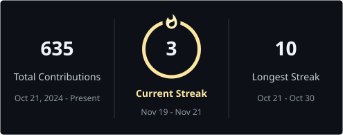
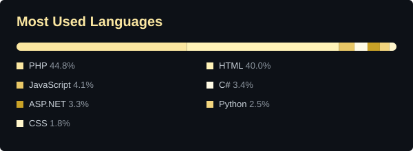

<h1 align="center">Hi, I'm Christeen (tyn)!</h1>

  

  

  <b>BSIT · Cybersecurity · Mapúa Malayan Colleges Laguna · Laguna, PH</b> 
  Blending creativity and technology to build meaningful digital experiences.

  
  
  

## A Little About Me

I'm a fourth-year **BS Information Technology** student majoring in **Cybersecurity** at **Mapúa Malayan Colleges Laguna** (Class of 2027), with a soft spot for **UI/UX design, graphic design and front-end development**.

I like work that looks good *and* holds up: interfaces with personality on the outside, careful authentication, access control and encryption underneath. Outside of code I'm the **Creatives Director of the Infotech Society**, where I design pubmats, presentations and merch, and I've been a **Dean's Lister for six terms**.

This is where I keep the things I build, from capstone systems to tiny pixel-art apps I draw myself.

## A Few Things I've Made

| Project | A little about it | Explore |
| --- | --- | --- |
| **ProfilePath** | My capstone: a career profiling system for senior high school students, with a RIASEC interest assessment, career recommendations, and counselor and admin tools for monitoring, security and reporting. | [Live site](https://profilepath-careerprofilingsystem.onrender.com/student-login) · [Repository](https://github.com/tynsoo/CareerProfilingSystem) |
| **Cookie Timer** | A pixel-art cookie baking countdown timer with presets, multiple trays, an 8-bit chime and dark mode. I drew all the art and buttons myself. | [Try it online](https://tynsoo.github.io/Cookie-Timer/) · [Repository](https://github.com/tynsoo/Cookie-Timer) |
| **Escape Room Timer** | A real-time 30-minute escape room timer with an admin control panel, built with Express and Socket.IO for a Foundation Week event. | [Repository](https://github.com/tynsoo/escape-room-30-mins-timer) |
| **Portfolio** | My personal portfolio, styled like a little desktop OS with folders, a quick-look window and a works table. | [Visit](https://tynsoo.github.io/Portfolio/) · [Repository](https://github.com/tynsoo/Portfolio) |

## Languages & Tools

What I design, build and secure things with.

  
  
  
  
  
  
  
  
  
  
   
  
  
  
  
  
  
  

## Certifications

  
  
  
  
  
  

## GitHub Stats & Streaks

  
  

  

## Crumbs Along the Way

<picture>
  <source media="(prefers-color-scheme: dark)" srcset="https://raw.githubusercontent.com/tynsoo/tynsoo/output/snake-dark.svg" />
  <source media="(prefers-color-scheme: light)" srcset="https://raw.githubusercontent.com/tynsoo/tynsoo/output/snake.svg" />
  
</picture>

Let's make something beautiful and secure. ✦ <a href="https://tynsoo.github.io/Portfolio/#contact">Get in touch</a>

